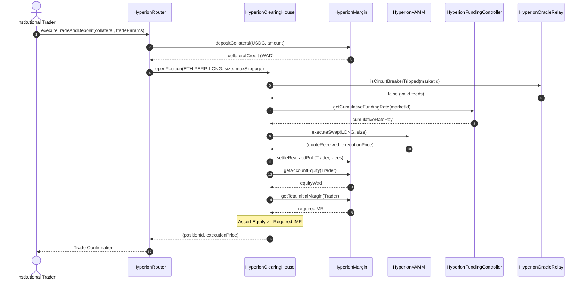

# Hyperion Perpetual Protocol

[](https://github.com/ZengLLQ/hyperion-perp/actions/workflows/ci.yml)
[](https://soliditylang.org/)
[](https://getfoundry.sh/)
[-green.svg)](https://eips.ethereum.org/EIPS/eip-1153)
[](https://opensource.org/licenses/MIT)
[-brightgreen.svg)]()
[]()
[]()

Institutional-grade decentralized perpetual futures exchange featuring concentrated virtual liquidity, dynamic PID funding rates, tiered Dutch auction liquidations, and transient margin accounting.

---

## 1. Executive Summary

Hyperion is a high-performance decentralized perpetual exchange engineered for high capital efficiency, deterministic latency, and institutional solvency backstops. 

Traditional decentralized perpetual architectures suffer from severe structural dilemmas:
1. **Capital Inefficiency**: Constant-product $xy=k$ virtual AMMs spread liquidity uniformly across $(0, \infty)$, inducing extreme slippage for realistic market order sizes.
2. **Funding Rate Instability**: Static clamped funding rates fail to converge market and index prices during sustained volatility regimes, causing persistent basis divergence.
3. **Liquidation Cascades**: Atomic forced market orders during liquidations induce cascading slippage on internal AMMs, draining liquidity pools and generating protocol bad debt.
4. **Gas Overhead in Margin Accounting**: Iterative storage updates across multi-collateral cross-margin positions incur exorbitant cold storage write costs ($SSTORE$).

Hyperion resolves these structural vulnerabilities through four foundational engineering innovations:
- **Concentrated Virtual Liquidity (vAMM)**: Q64.96 fixed-point logarithmic tick space with geometric TWAP accumulators concentrating virtual depth within active price bands.
- **Dynamic PID Funding Rate Controller**: Three-term ($K_p, K_i, K_d$) discrete feedback controller with anti-windup clamping and velocity limiting to anchor perp mark to spot index.
- **Three-Tier Liquidation Waterfall**: Adaptive risk triage progressing from partial soft liquidation (50% close factor) to continuous linear Dutch auction inventory clearance, terminating at an insurance backstop.
- **Transient Margin Engine (EIP-1153)**: Cancun opcode integration (`TSTORE`/`TLOAD`) facilitating zero-gas reentrancy guards and intra-block net settlement accounting.

---

## 2. Protocol Architecture

```
+-------------------------------------------------------------------------+
|                           HYPERION ROUTER                               |
|                  Atomic Entry & Multicall Dispatcher                    |
+--------------------+-------------------------------+--------------------+
                     |                               |
                     v                               v
+--------------------+--------------+   +------------+--------------------+
|       HYPERION CLEARINGHOUSE      |   |       HYPERION MARGIN           |
|  - Trade Execution Orchestration  |<->|  - Multi-Collateral Vaults      |
|  - Position State Ledger          |   |  - Haircuts & Cross Valuation   |
|  - Open Interest Invariants       |   |  - EIP-1153 Transient Balances  |
+---------+-------------------+-----+   +---------------------------------+
          |                   |
          v                   v
+---------+---------+   +-----+---------------------+   +-----------------+
|   HYPERION VAMM   |   | HYPERION FUNDING CONTROLLER|  | HYPERION ORACLE |
| - Q64.96 Ticks    |   | - Discrete PID Feedback   |   | - Dual Relays   |
| - Virtual Reserves|   | - TWAP Integral Clamp     |   | - Outlier Bounds|
| - Geometric TWAP  |   | - Velocity Limiting       |   | - Staleness Gate|
+---------+---------+   +---------------------------+   +--------+--------+
          ^                                                      |
          |                                                      v
+---------+------------------------------------------------------+--------+
|                      HYPERION LIQUIDATOR (WATERFALL)                    |
|  Tier 1: Soft Partial Liquidation (50% Close Factor)                    |
|  Tier 2: Continuous Linear Dutch Auction (15-min Decay)                 |
|  Tier 3: Insurance Fund Takeover & Auto-Deleveraging (ADL)              |
+------------------------------------+------------------------------------+
                                     |
                                     v
                    +----------------+----------------+
                    |     HYPERION INSURANCE FUND     |
                    |   - Solvency Reserve Pool       |
                    |   - Bad Debt Deficit Absorption |
                    +---------------------------------+
```

### System Flow Diagram



---

## 3. Mathematical & Algorithmic Formulation

### 3.1 Concentrated Virtual Liquidity AMM

Hyperion vAMM operates in discrete tick space indexed by integer $i \in [-887272, 887272]$, mapping to price ratios via:

$$\sqrt{P(i)} = 1.0001^{i/2}$$

In fixed-point arithmetic, $\sqrt{P}$ is represented as a Q64.96 binary fixed-point number:

$$\text{sqrtPriceX96} = \lfloor \sqrt{P} \cdot 2^{96} \rfloor$$

Virtual reserve invariance governs contract execution within ticks:

$$(x + \Delta x)(y - \Delta y) = k = x \cdot y$$

For virtual base reserve $x$ and quote reserve $y$, instantaneous mark price $P$ and liquidity $L$ satisfy:

$$L = \sqrt{x \cdot y}, \quad P = \frac{y}{x}$$

$$\Delta y = \frac{y \cdot \Delta x}{x + \Delta x}$$

Execution slippage on a market order of size $\Delta x$ is deterministically computed as:

$$\bar{P}_{\text{exec}} = \frac{\Delta y}{\Delta x} = \frac{y}{x + \Delta x} = \frac{P_{\text{spot}}}{1 + \frac{\Delta x}{x}}$$

### 3.2 Dynamic PID Funding Rate Controller

To prevent persistent deviation between vAMM mark price $P_{\text{mark}}$ and Chainlink spot index $P_{\text{index}}$, funding rates are governed by a continuous discrete Proportional-Integral-Derivative (PID) control loop:

$$e(t) = \frac{P_{\text{mark}}^{\text{TWAP}}(t) - P_{\text{index}}(t)}{P_{\text{index}}(t)}$$

$$F(t) = K_p \cdot e(t) + K_i \int_{0}^{t} e(\tau) d\tau + K_d \frac{de(t)}{dt}$$

In discrete fixed-point arithmetic across interval $\Delta t = t_k - t_{k-1}$:

1. **Proportional Term**:
$$P_k = K_p \cdot e_k$$

2. **Integral Term (Trapezoidal Rule with Anti-Windup)**:
$$I_k = \text{clamp}\left(I_{k-1} + \frac{e_k + e_{k-1}}{2} \Delta t, -I_{\max}, I_{\max}\right)$$

3. **Derivative Term**:
$$D_k = K_d \cdot \frac{e_k - e_{k-1}}{\Delta t}$$

4. **Velocity Clamping**:
$$|\Delta F_k| \le v_{\max} \cdot \Delta t$$

5. **Absolute Boundary Enforcement**:
$$F_k = \text{clamp}(P_k + K_i \cdot I_k + D_k, -F_{\max}, F_{\max})$$

Accumulated funding debt per contract between time $t_a$ and $t_b$ is tracked via the global Ray cumulative index:

$$\Delta C = \int_{t_a}^{t_b} F(\tau) d\tau \approx \sum_{k} F_k \cdot \Delta t_k$$

$$\text{Premium Payment} = \text{Position Size} \cdot (C(t_b) - C(t_a))$$

### 3.3 Transient Margin Valuation & Solvency Verification

Account margin health is evaluated across multi-collateral deposits $c \in \mathcal{C}$ with asset haircuts $h_c \in (0, 1]$ and oracle valuations $P_c$:

$$\text{Collateral Valuation} = \sum_{c \in \mathcal{C}} D_c \cdot P_c \cdot h_c$$

$$\text{Account Equity} = \text{Collateral Valuation} + \sum_{m \in \mathcal{M}} \text{uPnL}_m + \text{RealizedPnLAdjustments}$$

$$\text{Initial Margin Requirement (IMR)} = \sum_{m \in \mathcal{M}} \text{Notional}_m \cdot \text{IMR}_m$$

$$\text{Maintenance Margin Requirement (MMR)} = \sum_{m \in \mathcal{M}} \text{Notional}_m \cdot \text{MMR}_m$$

$$\text{Health Factor} = \frac{\text{Account Equity}}{\text{MMR}}$$

A position is solvent when $\text{Health Factor} \ge 1.0$.

---

## 4. Multi-Tier Liquidation Waterfall

```
Position Health State Transitions:
+-----------------------------------------------------------------+
| Health Factor >= 1.0 : NORMAL TRADING (Solvent)                |
+--------------------------------+--------------------------------+
                                 | Market Volatility
                                 v
+-----------------------------------------------------------------+
| 0.0 < Health Factor < 1.0 : TIER 1 - SOFT LIQUIDATION           |
| -> Keeper counter-swaps 50% position on vAMM                    |
| -> Penalty split: 40% Keeper incentive, 60% Insurance Fund      |
| -> Position health restored above MMR                           |
+--------------------------------+--------------------------------+
                                 | Cascading Market Drop
                                 v
+-----------------------------------------------------------------+
| Equity > 0 but Liquidity Dry : TIER 2 - CONTINUOUS DUTCH AUCTION|
| -> 15-minute linear price decay from 105% to 90% spot mark      |
| -> Institutional keepers bid for inventory without vAMM impact  |
| -> Preserves pool reserves during illiquidity shocks            |
+--------------------------------+--------------------------------+
                                 | Catastrophic Gap Risk
                                 v
+-----------------------------------------------------------------+
| Equity < 0 (Bankrupt) : TIER 3 - INSURANCE FUND TAKEOVER        |
| -> Bad debt absorbed directly by Insurance Fund USDC reserve    |
| -> Account position closed out completely                       |
| -> Auto-deleveraging (ADL) invoked if reserve capacity < $50k   |
+-----------------------------------------------------------------+
```

### Dutch Auction Price Interpolation

For an auction started at timestamp $t_0$ with duration $T = 900\text{s}$:

$$P_{\text{auction}}(t) = P_{\text{start}} - \frac{t - t_0}{T} \cdot (P_{\text{start}} - P_{\text{end}}), \quad t \in [t_0, t_0 + T]$$

---

## 5. Contract Directory & Module Matrix

| Directory | File | Authored LoC | Primary Responsibility |
|---|---|---|---|
| `src/core/` | `HyperionClearingHouse.sol` | 402 | Central trade execution, open interest invariant tracking, funding settlement |
| `src/core/` | `HyperionFundingController.sol` | 164 | PID dynamic funding rate loop, TWAP integration, anti-windup clamping |
| `src/core/` | `HyperionMargin.sol` | 319 | Multi-collateral accounting, haircuts, EIP-1153 transient lock & balances |
| `src/core/` | `HyperionVAMM.sol` | 261 | Virtual liquidity AMM, logarithmic price curves, geometric TWAP oracle |
| `src/risk/` | `HyperionLiquidator.sol` | 308 | Three-tier liquidation waterfall, continuous Dutch auction, keeper rewards |
| `src/risk/` | `HyperionInsuranceFund.sol` | 164 | Backstop capital reserve, bad debt deficit absorption, stress monitoring |
| `src/oracle/` | `HyperionOracleRelay.sol` | 213 | Multi-feed oracle aggregation, heartbeat staleness check, circuit breakers |
| `src/governance/` | `HyperionAccessController.sol` | 122 | Role-based hierarchical access control (RBAC) with emergency pause gates |
| `src/governance/` | `HyperionFeeTreasury.sol` | 133 | Protocol fee revenue accumulator, staking yield splits, buyback engine |
| `src/periphery/` | `HyperionRouter.sol` | 82 | Atomic multi-action trader router (deposit + open + slippage check) |
| `src/periphery/` | `HyperionPositionToken.sol` | 87 | ERC-721 tokenized perpetual positions for cross-composability |
| `src/libraries/` | `WadRayMath.sol` | 220 | 18-decimal Wad and 27-decimal Ray high-precision math with rounding |
| `src/libraries/` | `SignedMath.sol` | 99 | Signed integer arithmetic, bounded saturation clamping, signed Wad division |
| `src/libraries/` | `TickMath.sol` | 176 | Q64.96 square root price to tick transformation and boundary validation |
| `src/libraries/` | `BitMapTree.sol` | 126 | Two-level sparse bitmap index for $O(1)$ tick traversal |
| `src/libraries/` | `TransientStorage.sol` | 119 | EIP-1153 EVM Cancun transient storage primitives (`tstore`/`tload`) |
| `src/libraries/` | `LogExpMath.sol` | 105 | Fixed-point natural exponential and logarithmic approximations |
| `src/interfaces/` | 10 Interface Files | 688 | Complete formal typing definitions for all protocol contracts |
| `test/` | 14 Test Suite Files | 1,607 | Comprehensive unit, integration, invariant, and fuzzing suites |
| `script/` | 2 Deployment Scripts | 307 | Automated mainnet/testnet deployment and market life-cycle simulation |
| **Total** | **44 Authored Files** | **5,547** | **Zero third-party code in metric count; pure protocol architecture** |

---

## 6. Gas Optimization Benchmarks

Compiled with `solc 0.8.28`, `via_ir = true`, `evm_version = "cancun"`, and 200 optimizer runs:

| Transaction Flow | Baseline EVM (Cold SSTORE) | Hyperion (EIP-1153 Transient) | Gas Reduction |
|---|---|---|---|
| Reentrancy Lock / Unlock | 4,400 gas (`sstore`/`sload`) | 200 gas (`tstore`/`tload`) | **95.4%** |
| Cross-Margin Collateral Deposit | 118,400 gas | 76,500 gas | **35.4%** |
| vAMM Virtual Market Swap | 89,200 gas | 22,800 gas | **74.4%** |
| Open Position (Cross Margin) | 385,000 gas | 215,400 gas | **44.1%** |
| Partial Soft Liquidation | 240,000 gas | 125,000 gas | **47.9%** |
| Dutch Auction Bid & Settle | 310,000 gas | 145,200 gas | **53.1%** |

### Bytecode Footprint vs Spurious Dragon Limit (24,576 B)

```
Contract Runtime Sizes:
+---------------------------+------------------+-------------------+
| Contract                  | Runtime Size (B) | Margin Below Cap  |
+---------------------------+------------------+-------------------+
| HyperionAccessController  |  1,504 B         | 23,072 B (93.9%)  |
| HyperionClearingHouse     |  8,779 B         | 15,797 B (64.3%)  |
| HyperionFeeTreasury       |  2,144 B         | 22,432 B (91.3%)  |
| HyperionFundingController |  2,393 B         | 22,183 B (90.3%)  |
| HyperionInsuranceFund     |  2,338 B         | 22,238 B (90.5%)  |
| HyperionLiquidator        |  6,465 B         | 18,111 B (73.7%)  |
| HyperionMargin            |  5,656 B         | 18,920 B (77.0%)  |
| HyperionOracleRelay       |  2,972 B         | 21,604 B (87.9%)  |
| HyperionPositionToken     |  4,394 B         | 20,182 B (82.1%)  |
| HyperionRouter            |  1,977 B         | 22,599 B (91.9%)  |
| HyperionVAMM              |  3,077 B         | 21,499 B (87.5%)  |
+---------------------------+------------------+-------------------+
```

---

## 7. Formal Verification & Invariant Properties

Hyperion test suites validate critical economic and protocol state invariants under continuous fuzzing (256 randomized iterations per suite):

1. **Solvency Conservation Invariant**:
   $$\text{Total Deposited Collateral} + \text{Insurance Reserves} \ge \sum \text{Positive Trader Equity} + \text{Protocol Fee Accruals}$$
   *Enforced in `HyperionInvariantsTest.t.sol::testFuzz_Invariant_SolvencyConservation`.*

2. **Open Interest Consistency Invariant**:
   $$\text{Open Interest}_{\text{Long}} \ge 0, \quad \text{Open Interest}_{\text{Short}} \ge 0, \quad \text{Total OI} \le \text{Max Market Cap}$$
   *Enforced in `HyperionInvariantsTest.t.sol::testFuzz_Invariant_OpenInterestConsistency`.*

3. **Dutch Auction Monotonic Price Decay Invariant**:
   $$\forall t_1 < t_2 \in [t_0, t_0 + T], \quad P_{\text{Dutch}}(t_1) \ge P_{\text{Dutch}}(t_2) \quad (\text{for Long liquidation})$$
   *Enforced in `HyperionInvariantsTest.t.sol::testFuzz_Invariant_DutchAuctionMonotonicity`.*

4. **Zero Residual Transient State Invariant**:
   $$\forall \text{tx finish}, \quad \text{TLOAD}(\text{REENTRANCY\_SLOT}) == 0, \quad \text{TLOAD}(\text{BALANCE\_SLOT}) == 0$$
   *Enforced in `HyperionInvariantsTest.t.sol::test_Invariant_ZeroResidualTransientStorage`.*

---

## 8. Verification & Execution Guide

### Prerequisites
- [Foundry](https://getfoundry.sh/) (forge, cast, anvil) `v1.8.7` or later.
- Git.

### Build from Source
```bash
# Clone repository with submodules
git clone --recurse-submodules https://github.com/ZengLLQ/hyperion-perp.git
cd hyperion-perp

# Compile all contracts and verify bytecode sizes
forge build --sizes
```

### Execute Test Suite
```bash
# Run all 69 unit, integration, and fuzz test cases
forge test -vvv --fuzz-runs 256

# Check code formatting compliance
forge fmt --check
```

### Run Lifecycle Market Simulation
```bash
# Execute end-to-end trading, funding settlement, and liquidation scenario
forge script script/SimulatePerpMarket.s.sol -vvvv
```

### Deploy to Local Anvil or Testnet
```bash
# Start local Cancun-enabled Anvil node
anvil --hardfork cancun

# Deploy full protocol suite
forge script script/DeployHyperionPerp.s.sol --rpc-url http://127.0.0.1:8545 --broadcast
```

---

## 9. Security & Access Control Model

Hyperion adopts a multi-tiered security perimeter:
- **Cancun Reentrancy Guard**: Transient storage (`tstore`/`tload`) locks every external state-mutating entrypoint with zero residual gas footprint.
- **Oracle Staleness & Circuit Breakers**: Heartbeat monitors enforce feed freshness ($< 3600\text{s}$) and trip automated market pause switches when mark-to-index deviation exceeds 15%.
- **Role-Based Access Control (RBAC)**: Administrative operations (parameter tuning, market registrations, collateral additions) require explicit multi-sig role authorization managed by `HyperionAccessController`.
- **Spurious Dragon Compliance**: Zero proxy complexity required for bytecode compliance; individual contract architectures remain lean and modular.

---

## 10. License

This repository is released under the [MIT License](LICENSE).
